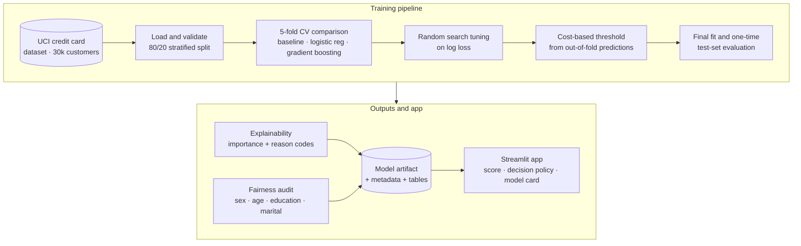
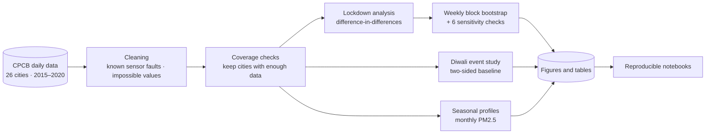
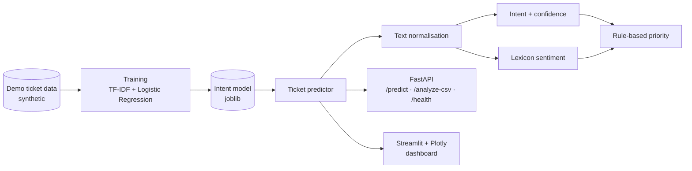

  <b>BTech CS Graduate (2026)</b>&nbsp;&nbsp;·&nbsp;&nbsp;Jaipur, Rajasthan, India&nbsp;&nbsp;·&nbsp;&nbsp;<b>immediate joining</b>

 

 

I'm Data Scientist and Machine Learning Engineer. I build machine learning projects end to end: cleaning and exploring data, training and comparing models, and putting the results behind an API or an interactive app that people can actually use.

**What I can work on**

- Exploratory data analysis and visual reporting with Pandas, Matplotlib and Seaborn
- Training, comparing and evaluating regression and classification models with scikit-learn
- Text classification pipelines for NLP problems (TF-IDF with linear models)
- Serving models through FastAPI services and Streamlit dashboards, backed by tests and CI

 

## About Me

- BTech (Computer Science and Engineering) graduate 
- Focused on Data Science and Machine Learning, especially turning raw data into models and tools that answer a concrete question.
- I build practical projects with real structure: reproducible notebooks, documented results, automated tests, and clearly stated limitations.
- Open to entry-level Data Scientist and Machine Learning Engineer roles, and available to start immediately.

 

## Technical Skills

**Programming**

**Data Science**

**Machine Learning**

**Tools used in my projects**

 

## Featured Projects

### [Credit Risk Scorer](https://github.com/siddharth0444/credit-risk-scorer)

Predicts which credit card customers will miss next month's payment, explains every score, and turns predictions into decisions based on what each kind of mistake costs. Built on 30,000 real customers.

- Gradient boosting model with **ROC-AUC 0.780** on a held-out test set, tuned on log loss; predicted and actual default rates agree within about 2 points.
- Decision threshold set by business cost rather than accuracy: catches 72% of defaulters at **27% lower cost** than the best strategy without a model.
- Per-customer reason codes and a fairness audit across sex, age, education and marital status, which are excluded from the model's inputs.
- Streamlit app to score customers and explore the decision policy; 32 tests and CI.

`Python` `scikit-learn` `Pandas` `Streamlit` `Matplotlib` `pytest` `GitHub Actions`

**Architecture**

<b>Screenshots</b>

 

  
  

### [India Air Quality Analysis](https://github.com/siddharth0444/india-air-quality-analysis)

How much did the 2020 COVID-19 lockdown and Diwali really change air quality in 26 Indian cities? An analysis of CPCB pollution data (2015–2020) that corrects for pre-existing trends instead of making a naive before-and-after comparison.

- Lockdown cut NO₂ by about 39% and PM2.5 by about 33% in the typical city, estimated with difference-in-differences and a weekly block bootstrap; the result holds under six alternative analysis choices.
- Diwali event study with a two-sided baseline that separates the festival spike from the seasonal rise in pollution.
- Found and documented sensor faults that change conclusions, such as a faulty CO sensor that made Ahmedabad's AQI look worse than Delhi's.
- Tested analysis package, reproducible notebooks and CI.

`Python` `Pandas` `NumPy` `Matplotlib` `Seaborn` `pytest` `GitHub Actions`

**Architecture**

<b>Screenshots</b>

 

  
  

### [SupportIQ: Customer Support Intelligence](https://github.com/siddharth0444/supportiq-customer-support-intelligence)

An NLP analytics tool for support tickets that classifies ticket intent, estimates sentiment and flags urgent tickets for triage.

- Intent classification with TF-IDF and Logistic Regression.
- Lexicon-based sentiment baseline and a transparent, rule-based priority score.
- FastAPI endpoints for single-ticket and batch (CSV) prediction, plus a Streamlit and Plotly dashboard.
- Automated tests with pytest, linting with Ruff and a passing GitHub Actions CI pipeline.
- Currently trained on synthetic demo data. A human-labelled benchmark and model comparison are next on the roadmap.

`Python` `scikit-learn` `FastAPI` `Streamlit` `Plotly` `pytest` `GitHub Actions`

**Architecture**

### [Personal Portfolio Website](https://github.com/siddharth0444/siddharth-portfolio)

A notebook-style portfolio that presents my projects with their real result charts and key metrics, built as a single-page React application and deployed on Vercel.

`React` `Vite` `JavaScript` `CSS` `Vercel`

 

## GitHub Statistics

<picture>
  <source media="(prefers-color-scheme: dark)" srcset="https://github-profile-summary-cards.vercel.app/api/cards/stats?username=siddharth0444&theme=github_dark" />
  
</picture>
<picture>
  <source media="(prefers-color-scheme: dark)" srcset="https://github-profile-summary-cards.vercel.app/api/cards/most-commit-language?username=siddharth0444&theme=github_dark" />
  
</picture>

 

<picture>
  <source media="(prefers-color-scheme: dark)" srcset="https://streak-stats.demolab.com?user=siddharth0444&theme=github-dark-blue&hide_border=true&background=0D1117" />
  
</picture>

 

## Connect With Me

 

I'm looking for entry-level Data Science and Machine Learning roles where I can work on real data problems If you're hiring, or would like to collaborate on an ML project, I'd be glad to hear from you.

  

